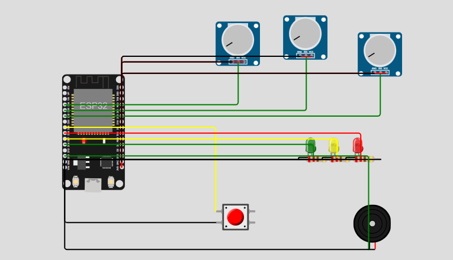
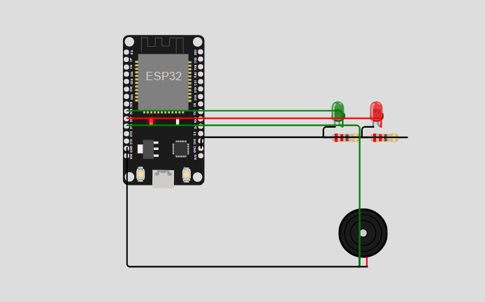
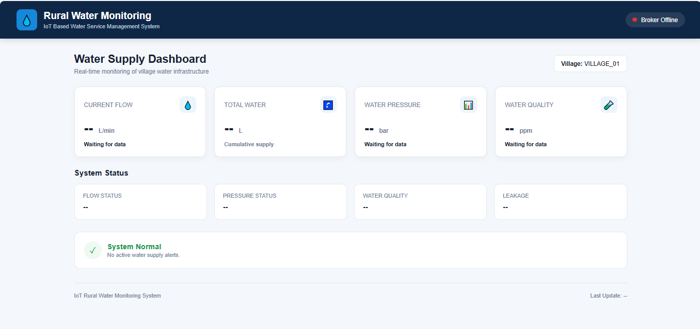

# Smart Rural Water Monitoring System 💧

An IoT-based project idea to monitor water supply in rural areas and help identify problems such as irregular supply, low pressure, leakage, and water-quality changes.

## 📌 About the Project

The aim is to build a system using ESP32 sensor nodes and a central gateway to collect water-related data and display it on a website dashboard.

The system is designed with rural areas in mind, where connectivity and power supply can sometimes be unreliable.

## ⚙️ How It Works

1. **Sensor Nodes** — Collect readings such as water flow, pressure, and TDS.
2. **Central Gateway** — Receives sensor data and forwards it using MQTT.
3. **Web Dashboard** — Displays readings and system status.
4. **Emergency Alert** — A button can trigger an alert for a possible leakage or other water-supply issue.

## 🛠️ Technologies Used

- ESP32
- C/C++ (Arduino framework)
- MQTT
- HTML, CSS, and JavaScript
- Wokwi for circuit simulation

## ✨ Planned Features

- Live water-flow and pressure monitoring
- Total water-usage tracking
- Basic water-quality monitoring using TDS readings
- Leakage and emergency alerts
- Website dashboard with automatic updates

## 📍 Project Status

Prototype development and simulation.

Some features may still be under development. This repository will be updated as the project progresses.

## 🎯 Goal

To explore how affordable IoT technology can help improve water-supply monitoring and management in rural communities.
## 📸 Project Screenshots

### Sensor Node

### Gateway

### Website Dashboard

## 🔗 Wokwi Simulation

[View Sensor Node Simulation](https://wokwi.com/projects/476318022500616193)
[View Gateway Simulation](https://wokwi.com/projects/476320556889458689)
